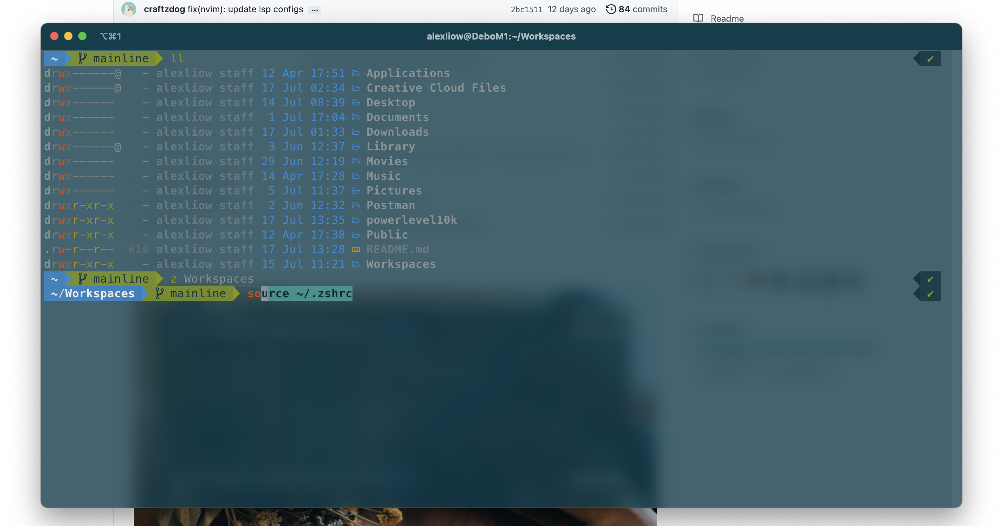

# dotfiles

## Description
Configuration files for current dev environment (Apple Silicon macOS, iTerm2, zsh).

## New Mac setup
1. Add an SSH key to GitHub, then `mkdir -p ~/workspaces && cd ~/workspaces && git clone git@github.com:liowalex/dotfiles.git`
2. Install [Homebrew](https://brew.sh), then add it to your PATH:
   `echo 'eval "$(/opt/homebrew/bin/brew shellenv zsh)"' >> ~/.zprofile`
3. `brew bundle --file ~/workspaces/dotfiles/Brewfile`
4. Install oh-my-zsh + plugins:
   ```sh
   git clone --depth=1 https://github.com/ohmyzsh/ohmyzsh.git ~/.oh-my-zsh
   C=~/.oh-my-zsh/custom
   git clone --depth=1 https://github.com/romkatv/powerlevel10k.git $C/themes/powerlevel10k
   git clone --depth=1 https://github.com/zsh-users/zsh-autosuggestions $C/plugins/zsh-autosuggestions
   git clone --depth=1 https://github.com/zsh-users/zsh-syntax-highlighting $C/plugins/zsh-syntax-highlighting
   git clone --depth=1 https://github.com/zsh-users/zsh-completions $C/plugins/zsh-completions
   ```
5. Symlink configs: `ln -sf ~/workspaces/dotfiles/.zshrc ~/.zshrc && ln -sf ~/workspaces/dotfiles/.p10k.zsh ~/.p10k.zsh && mkdir -p ~/.config/git && ln -sf ~/workspaces/dotfiles/git/ignore ~/.config/git/ignore`
6. Fonts: install MesloLGS NF (or run `p10k configure`, which offers to install it)
7. Runtimes: `mise use -g node@lts python@3.14`
8. Nix + devenv: `curl -fsSL https://install.determinate.systems/nix | sh -s -- install`, then `nix profile add nixpkgs#devenv`
9. iTerm2: copy the StudioLight profile (unlimited scrollback) into
   `~/Library/Application Support/iTerm2/DynamicProfiles/` (wrapped as `{"Profiles": [ ... ]}`) and set it as default.

## Tooling
* **mise** – Node/Python versions. `mise use node@22` in a project writes `mise.toml`; `mise use -g` sets global.
* **uv** – Python packages/venvs (`uv init`, `uv add`, `uv run`, `uvx <tool>`).
* **devenv + direnv** – reproducible per-project envs (`devenv init`, then `direnv allow`).
* **fzf** – Ctrl-R fuzzy history, Ctrl-T files, Alt-C cd (replaces zsh-peco-history).
* **eza** – `ll`, `lt` (replaces the deprecated exa).
* History: 1,000,000 lines, timestamped, shared across tabs. Prefix a command with a space to skip history.

## Example in iterm2

